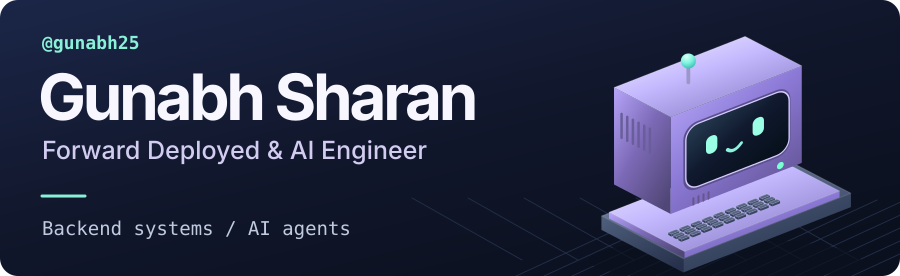
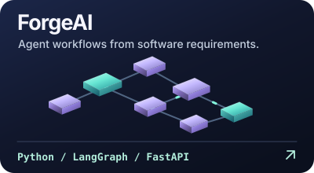
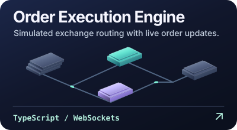
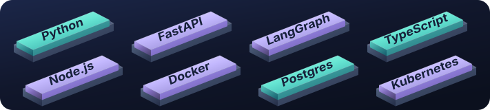

I build backends and AI agents in Python and TypeScript. Two of my projects explore what happens after a request arrives — how agents divide up work and how an order moves through a queue.

[LinkedIn](https://www.linkedin.com/in/gunabh25/) · [Engineering notes](https://hashnode.com/@gunabh) · [Email](mailto:gunabhsharan.25@gmail.com)

## Selected projects

 

## GitHub activity

How the activity is counted

The commit totals use GitHub’s author search across indexed default branches visible to the refresh account. Each tower represents one day on my contribution calendar. The streak counts consecutive days with any qualifying contribution, including commits, issues, pull requests, and reviews.

## Tools I work with

