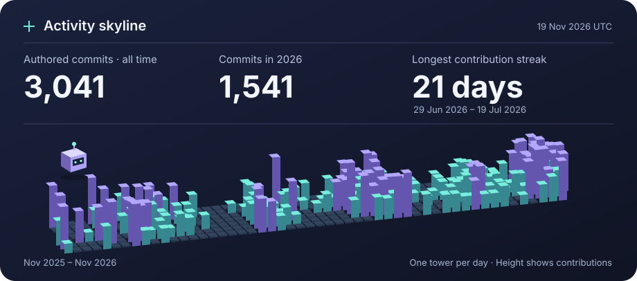

I’m a forward deployed and AI engineer in Mumbai. I work on backend systems at OnFinance AI. Two of my own projects live here.

**[POS Agent](https://github.com/gunabh25/pos-agent)** connects checkout software to the hardware on the counter. A local Node.js service handles receipt printers, barcode scanners, scales, cash drawers, and payment terminals.

**[ForgeAI](https://github.com/gunabh25/forge-ai-langgraph)** takes a software requirement and builds a graph of tasks for AI agents. When a requirement changes, it can rerun the affected tasks. I built it with Python, FastAPI, and LangGraph.

[Engineering notes](https://hashnode.com/@gunabh) · [LinkedIn](https://www.linkedin.com/in/gunabh25/) · [Email me](mailto:gunabhsharan.25@gmail.com)

About the numbers

The commit totals come from GitHub’s author search across indexed default branches visible to the refresh account. Each tower represents a day on my contribution calendar. The streak counts consecutive days with a qualifying contribution.

